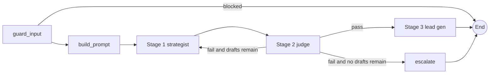

# Growth OS

**One platform. Multiple clients. One unified growth workflow. Minimal operational effort for the client.**

Growth OS is a multi-client operations platform for a done-for-you growth agency. It turns a short content brief into a judged strategy and a set of publish-ready lead generation assets in a specific client's voice, then carries those assets through approval, manual publishing, campaigns, lead tracking and reporting. The clients (busy founders and executives) never touch anything. The agency's account managers run everything from one place.

This document explains what problem the product solves, why each part exists, how to use every section, how the AI pipeline and its guardrails work, how metrics are calculated, and what is honestly not built yet.

---

## Table of contents

1. [The problem this solves](#1-the-problem-this-solves)
2. [Who uses it and what they get](#2-who-uses-it-and-what-they-get)
3. [Design principles](#3-design-principles)
4. [Quick start](#4-quick-start)
5. [Configuration reference](#5-configuration-reference)
6. [Application tour](#6-application-tour)
   - [6.1 Shell: navigation, header and sidebar](#61-shell-navigation-header-and-sidebar)
   - [6.2 Overview](#62-overview)
   - [6.3 Clients](#63-clients)
   - [6.4 Content Studio](#64-content-studio)
   - [6.5 Content Calendar](#65-content-calendar)
   - [6.6 Lead Generation](#66-lead-generation)
   - [6.7 Campaigns](#67-campaigns)
   - [6.8 Analytics](#68-analytics)
   - [6.9 Run History](#69-run-history)
   - [6.10 Settings](#610-settings)
7. [The AI pipeline in detail](#7-the-ai-pipeline-in-detail)
8. [Guardrails](#8-guardrails)
9. [Access control and client isolation](#9-access-control-and-client-isolation)
10. [Metric definitions](#10-metric-definitions)
11. [Data model and storage](#11-data-model-and-storage)
12. [Architecture and code map](#12-architecture-and-code-map)
13. [Testing and validation](#13-testing-and-validation)
14. [Troubleshooting](#14-troubleshooting)
15. [Honest gaps and roadmap](#15-honest-gaps-and-roadmap)
16. [Five-minute demo script](#16-five-minute-demo-script)

---

## 1. The problem this solves

### The business situation

A growth agency is launching a "Growth OS" for its clients: a portal that handles **content marketing, personal branding and lead generation** as a done-for-you service. There are **12 clients waiting** to be onboarded next month. Each is a busy founder or executive who explicitly does not want to touch anything. The agency runs everything on their behalf.

### The problems in doing this manually or with generic tools

| Problem | What happens without Growth OS | How Growth OS addresses it |
|---|---|---|
| **Brand drift across clients** | A generic AI chat tool has no memory of each client's voice, proof points or banned topics. Writers paste context by hand and mix clients up. | Every client has a stored brand profile. The pipeline injects the universal rules plus only that client's profile into every run. |
| **Unverified AI output** | AI copy invents statistics, promises guaranteed results, uses banned phrases or cites facts the client never stated. One bad post damages a founder's personal brand. | A judge agent scores the draft, and deterministic checks in code block banned phrases, absolute claims, unverified numbers and off-profile contact details. The judge cannot approve what the checks reject. |
| **One-shot generation with no quality loop** | A single prompt gives a single answer. Weak drafts ship because nobody has time to iterate. | A bounded revise loop sends the judge's feedback back to the strategist, and a human can request further revisions that produce tracked versions. |
| **No audit trail or version control** | Edits overwrite earlier drafts. Nobody can say what was approved, by whom, or what changed. | Packages are versioned and never overwritten. Approvals, edits, plans and overrides are recorded in an audit log. |
| **Client data mixing** | In a shared workspace an account manager can accidentally publish one client's content under another. | Client access is enforced in the backend on every read and write, not only in dropdowns. |
| **Onboarding 12 clients is chaotic** | Intake details live in documents and heads. Nobody knows which clients are ready to launch. | A repeatable 12-step onboarding checklist per client, derived from real data where possible and resumable at any time. |
| **Content and sales are disconnected** | Posts get published, but nobody can tie them to leads or campaigns, so ROI is anecdotal. | Assets, campaigns and leads are linked. Analytics report only recorded data and clearly say where data is missing. |
| **Hidden AI cost and latency** | Teams cannot say what a piece of content cost or how long it took. | Every run records tokens, estimated cost, end-to-end latency and model time, with honest labels. |
| **Over-claiming** | Dashboards show fabricated numbers to look impressive. | Nothing is fabricated. Unavailable metrics show "Not available" with the integration that would supply them. |

### Why a single platform

The brief was explicit: one platform where content, branding and lead generation happen end to end. Separate tools for drafting, review, calendar, CRM and reporting would each need their own client context and would lose the link between a piece of content and the leads it produced.

---

## 2. Who uses it and what they get

| Role | In the app | What they need |
|---|---|---|
| **Growth lead** (Rohan) | Has access to all client workspaces | Portfolio view, onboarding progress across 12 clients, cost and quality trends |
| **Account manager** (Aarav) | Sees a subset of clients (six by default) | Run the pipeline, review, approve, plan content, track leads for their clients |
| **Content operations** (Meera) | Sees a different subset (six by default) | Produce and refine content, manage the calendar |
| **Client** (founder or executive) | Not a user | Receives finished work. Their only touchpoint is the intake that fills the brand profile |

The default operators and their client access are defined in `prompt.json` under `operators` and `operator_access`. The user selector is an identity stub, not authentication (see [gaps](#15-honest-gaps-and-roadmap)).

---

## 3. Design principles

1. **Enhance, do not replace.** The original three-stage pipeline (strategist, judge, lead specialist), the revision loop, the run store, JSON download and run history all remain and were extended.
2. **Code decides, the model advises.** The judge produces scores and feedback, but approval is computed in code from scores plus deterministic findings.
3. **Never fabricate.** No fake leads, fake metrics, fake success messages or silent no-op buttons. Missing integrations are labelled "Not configured" and handled as manual workflows.
4. **Never overwrite.** Revisions create new versions. Editing approved content returns it to pending approval.
5. **Isolation by construction.** Every service call takes the acting user and checks client access.
6. **Honest labelling.** Estimates are called estimates. Tokens are "reported by the AI service". Latency is shown end to end and as model time separately.
7. **No secrets or vendor details in the interface.** Credentials stay on the server. The UI shows a neutral AI model label, not the underlying provider or deployment names, and error messages shown to users are generic (details go to the server log).

---

## 4. Quick start

### Requirements

- Python 3.13 (3.11 or newer should work)
- A `.env` file in the project root with the AI service credentials (see [configuration](#5-configuration-reference))

### Install and run

```
pip install -r requirements.txt
streamlit run app.py
```

Open the URL Streamlit prints, normally `http://localhost:8501`. The first load takes a few seconds while the app initialises the database.

### Run the tests

```
python -m pytest
```

The tests use a scripted fake model, so they need no network access and cost nothing.

### First-time checklist

1. Open **Settings → Integrations** and confirm the AI service shows **Configured**.
2. Open **Clients** and confirm 12 workspaces appear for the default user.
3. Open **Content Studio** and run one brief to confirm the pipeline works end to end.

---

## 5. Configuration reference

All values come from environment variables, loaded from `.env`. Defaults live in `growth_os/config.py`. Invalid numbers raise a clear configuration error at startup.

### AI service connection (server side only, never displayed)

| Variable | Purpose |
|---|---|
| `AZURE_OPENAI_API_KEY` | Credential for the AI service |
| `AZURE_OPENAI_ENDPOINT` | Service endpoint |
| `AZURE_OPENAI_API_VERSION` | API version (default `2024-12-01-preview`) |
| `AZURE_DEPLOYMENT_NAME` | Model deployment used for all three stages |
| `MODEL_DISPLAY_NAME` | Neutral label shown in the UI and exports (default `Growth OS Language Model`) |

The settings object hides the API key from its string representation, so it cannot leak into logs or test output.

### Pipeline policy

| Variable | Default | Meaning |
|---|---|---|
| `MAX_REVISIONS` | 3 | Maximum strategist/judge rounds before escalating to a human |
| `JUDGE_MIN_SCORE` | 7 | Minimum score required in every dimension |
| `JUDGE_MIN_AVERAGE` | 7.8 | Minimum average across the five dimensions |
| `ASSET_ATTEMPTS` | 3 | Attempts to produce guardrail-clean lead assets |
| `BRIEF_MIN_CHARS` / `BRIEF_MAX_CHARS` | 15 / 1500 | Brief length bounds |
| `DAILY_RUNS_PER_CLIENT` | 40 | Non-blocked runs allowed per client per day |
| `LLM_TIMEOUT_SECONDS` | 90 | Per-call timeout |
| `STRATEGIST_TEMPERATURE` / `JUDGE_TEMPERATURE` / `LEAD_TEMPERATURE` | 0.7 / 0 / 0.6 | Sampling temperatures (judge is deterministic) |

### Cost and ROI assumptions

| Variable | Default | Meaning |
|---|---|---|
| `PRICE_INPUT_PER_MILLION` / `PRICE_OUTPUT_PER_MILLION` | 0.15 / 0.60 | List prices used to estimate cost |
| `ROI_HOURLY_RATE` | 60 | Value of an hour of manual work (USD) |
| `ROI_MINUTES_DRAFT` | 90 | Assumed manual minutes to write the long-form piece |
| `ROI_MINUTES_EMAIL` / `ROI_MINUTES_POST` / `ROI_MINUTES_CTA` | 20 / 10 / 5 | Assumed manual minutes per email, post and CTA |
| `ROI_MINUTES_REVIEW` | 10 | Human review time subtracted per run |
| `TARGET_CLIENTS` | 12 | Target shown as "active clients out of target" |

### Files and locations

| Variable | Default | Meaning |
|---|---|---|
| `PROMPT_FILE` | `prompt.json` | Universal prompt, stage instructions, sample clients, operator access |
| `GROWTH_OS_DATA_DIR` | `data/` | Where the database, run log and run outputs are stored |

---

## 6. Application tour

Every section below follows the same structure: **what it is and the problem it solves**, **why it is needed**, **how to use it**, and **rules and limits**.

### 6.1 Shell: navigation, header and sidebar

**What it is.** The persistent frame around every page: a left sidebar with the nine sections, and a header showing the page title, the **Active client** selector and the **Signed in as** selector.

**Problem solved.** Account managers juggle many clients. They need to know at all times which client they are working on and who is acting, so content is never created, approved or logged against the wrong client.

**Why it is required.** The active client drives Content Studio, the client-scoped filters on every page and the client context sent to the AI. The signed-in user drives backend access control and the audit log.

**How to use it.**
- Choose the **Active client** in the header. Every client-specific page defaults to it.
- Choose **Signed in as** to switch operator. The client list immediately narrows to that operator's clients.
- The sidebar bottom shows the workspace owner, how many client workspaces are accessible, whether the AI model is configured, and a reminder that publishing is manual.

**Rules and limits.**
- Switching user resets the active client if the previous client is not accessible to the new user.
- On narrow screens the sidebar collapses behind a toggle and columns stack into a single column.
- Success and failure messages appear as toasts or inline notices, and destructive actions use a confirmation dialog.

---

### 6.2 Overview

**What it is.** An executive dashboard that answers five questions: how many clients are active, what content is being created or published, which campaigns need attention, how many leads exist, and what the team should do next.

**Problem solved.** A growth lead managing 12 onboardings has no quick way to see portfolio health. Spreadsheets go stale and do not connect content, campaigns and leads.

**Why it is required.** It prevents things silently stalling: assets waiting for approval, follow-ups that are overdue, runs that failed, clients stuck in onboarding.

**What it shows (all computed from stored data).**

| Widget | Content |
|---|---|
| KPI cards | Active clients (and how many are onboarding), content assets created, awaiting approval, posts published (manually recorded), leads generated, campaign conversion rate |
| Recommended next actions | Generated from real conditions: assets awaiting approval, overdue follow-ups, the next onboarding step for a stalled client, the latest failed or escalated run, no campaigns yet, no runs yet. Each is a link to the right page |
| Pending content approvals | Assets awaiting approval with their status |
| Upcoming publishing schedule | Assets planned for publication, nearest first |
| Campaign performance | Campaign, client, status, asset count, lead count |
| Client onboarding progress | Progress bars, least complete first |
| Recent AI pipeline executions | Latest runs with status and judge score |
| Needs attention | Failed, blocked or escalated runs, overdue follow-ups, number of unconfigured integrations |
| Recent activity | The latest audit events across your clients |

**How to use it.** Start the day here. Follow a recommended action link, or scan the widgets for problems.

**Rules and limits.**
- **Campaign conversion** shows "Not available" until at least five leads exist, so a single lead cannot produce a misleading 100%.
- It never shows placeholder numbers. A new install shows zeros and clear empty-state messages.
- It only includes clients the signed-in user can access.

---

### 6.3 Clients

The Clients section has two views: the **directory** and a per-client **workspace**.

#### 6.3.1 Client directory

**Problem solved.** Finding a client, seeing where it stands and starting work shouldn't need a spreadsheet.

**Why it is required.** It is the entry point for onboarding and for switching between client workspaces without mixing up information.

**How to use it.**
1. Use **Search clients** (name, industry, founder or audience) and the **Status** filter (Onboarding, Active, Paused, Completed).
2. Read each client card: status badge, primary contact, target audience, growth objective, content counts, campaign and lead counts, last activity, and onboarding progress.
3. Click **Open workspace** to enter that client's workspace. This also makes it the active client.
4. Click **Add client** to create a new client record. You only need a name, founder, role and industry. The rest is completed during onboarding.

**Rules and limits.**
- The summary cards show accessible clients, how many are onboarding, how many are active and the average onboarding progress.
- The 12 sample clients start as **Onboarding**. They become **Active** when the "ready for launch" onboarding step is ticked.
- A client created in the UI is accessible to its creator and to operators with wildcard access.
- Client names must be unique in effect: a duplicate name gets a numeric suffix on its internal id.

#### 6.3.2 Client workspace

Open a client to see eight tabs. All data inside is scoped to that one client.

**Overview tab: onboarding and workspace settings**

*Problem solved:* Onboarding 12 clients needs a repeatable process that can be paused and resumed and that shows exactly what is missing.

*How it works:* A 12-step checklist is evaluated from real data.

| # | Step | How it is completed |
|---|---|---|
| 1 | Create client record | Automatic (the record exists) |
| 2 | Capture company and founder details | Automatic when founder, role and industry are filled |
| 3 | Define target audience | Automatic when the audience is filled |
| 4 | Capture business goals | Automatic when at least one goal exists |
| 5 | Configure brand voice | Automatic when voice and positioning are filled |
| 6 | Define content pillars | Automatic when at least one pillar exists |
| 7 | Add approved reference material | Automatic when at least one reference example exists |
| 8 | Configure channels and integrations | **Manual checkbox**. Confirms the channel plan. Publishing integrations are not configured, so publishing is manual |
| 9 | Generate initial content strategy | Automatic when any pipeline package exists |
| 10 | Generate sample assets | Automatic when a run passed the full quality gate |
| 11 | Review and approve initial assets | Automatic when at least one asset is approved |
| 12 | Mark the workspace ready for launch | **Manual checkbox**, available only when steps 1 to 11 are complete. Ticking it sets the client to **Active**. Unticking returns it to **Onboarding** |

The tab also shows the next step with its hint, a "Missing configuration" list, an assigned owner, internal notes, a status selector and the last-updated time.

*How to use it:* Work down the checklist. Fill the Brand Profile for steps 2 to 7, run Content Studio for 9 and 10, approve assets for 11, then tick 8 and 12.

**Brand Profile tab**

*Problem solved:* The AI must produce content in one specific person's voice using only facts that person has stated. Relying on manually typed prompts causes inconsistency.

*Why it is required:* This profile is the single source of client context. The pipeline retrieves it automatically on every run.

| Field | How it is used |
|---|---|
| Company name, founder, role, industry | Identity and attribution |
| Target audience | Who the content speaks to. Checked by the judge |
| Brand voice, writing style | Tone and style the judge scores against |
| Positioning, unique value proposition | The core argument of the content |
| Core expertise, content pillars | Topics the strategist should draw on and the pillars it reports back |
| Business goals | Shown in the client directory and used as context |
| Products or services | Offers the content can reference |
| **Proof points** | **The only facts the AI may cite.** Statistics not found here or in the brief are blocked |
| Primary CTA and additional CTAs | The call to action the closing must contain. You can choose among them per run |
| Banned phrases, prohibited topics | Enforced both in the prompt and by deterministic checks |
| Channels | Planned channels for the client |
| Primary contact name and email | Shown in the directory. Email is validated |
| Approved reference examples | Style references only. They are wrapped as untrusted text and never used as a source of facts |

A profile must have **audience, voice, positioning, offers and a primary CTA** before the pipeline will run. Otherwise Content Studio shows what is missing and links here.

Lists are entered one item per line. Reference examples are separated by a line containing `---`. Saving a partial profile never wipes other fields. Connected social accounts are not supported and the tab says so.

**Content tab**

Lists the client's working assets (strategy, emails, social posts, CTA sets) with the same actions as Content Studio (copy, edit, approve, request revision, plan or publish, export). Filter by approval status and asset type. This is the client-level library for review and approval.

**Calendar, Campaigns, Leads, Analytics tabs**

The same views as the global pages, pre-scoped to this client.

**Activity History tab**

An audit table of everything done in the workspace: profile saves, runs, approvals, edits, plans, lead changes. Exportable as CSV.

---

### 6.4 Content Studio

This is the primary operational workspace and the heart of the product.

**Problem solved.** Turning a loosely described idea into publish-ready, on-brand, compliant content takes a strategist, an editor and a lead-generation copywriter. Doing that for 12 clients by hand does not scale, and unreviewed AI output is risky.

**Why it is required.** It runs the three-stage workflow, shows every stage transparently, and keeps a human in control through approvals, edits and revisions.

#### 6.4.1 Input and configuration panel

| Control | Purpose | Notes |
|---|---|---|
| **Content brief** | What this piece should cover, who it is for, what readers should do | The main input. 15 to 1500 characters. Example prompts are offered, generated from the client's pillars and industry |
| **Content type** | Thought-leadership post, founder story, service spotlight, customer problem explainer, industry commentary, lead magnet teaser | Passed to the strategist and the judge |
| **Distribution channel** | Multi-channel, LinkedIn, Email, X | Passed as the primary channel |
| **Campaign objective** | Lead generation, authority, awareness, nurture, offer or event promotion | Passed as the objective the judge evaluates against |
| **Campaign** | Attach the output to a campaign, or none | Only the client's own campaigns are offered |
| **Primary CTA** | Choose among the client's configured CTAs | Defaults to the profile's primary CTA |
| **Client brand profile summary** | Read-only summary | Confirms which context will be used |

**Advanced settings** (collapsed by default)

| Control | Purpose |
|---|---|
| Audience focus | Overrides the audience for this run |
| Tone override | Overrides the voice for this run |
| Editorial notes | Anything the strategist must include or avoid |
| Maximum drafts (1 to 5) | Strategist/judge rounds before escalating |
| Minimum score per dimension (1 to 10) | Judge threshold |
| Minimum average score (1 to 10) | Judge threshold |

All free-text inputs go through the same injection checks as the brief. Thresholds are validated in the backend and apply only to that run.

#### 6.4.2 Generate Growth Assets

Pressing the button:
1. Validates the active client and the brief.
2. Retrieves the client profile and injects it with the universal prompt.
3. Runs the real pipeline.
4. Saves the output as a versioned package with individually approvable assets.

Identical concurrent requests are rejected. Runs are limited per client per day.

#### 6.4.3 Execution state (stage tracker)

Four cards show **Brief validation**, **Stage 1 Content Strategist**, **Stage 2 LLM Judge** and **Stage 3 Lead Gen Specialist**. Each shows one of **Queued, Running, Completed, Needs revision** or **Failed**, the start time and the duration. A stage is shown as Completed only after its work actually succeeded. If the judge sends a draft back, the strategist card shows the next draft being produced. No progress percentages are invented.

#### 6.4.4 Stage 1: Content Strategist

The strategy is shown as structured sections: headline, campaign objective, target audience, core message, content angle, suggested hook, recommended format, primary CTA, audience pain points, content pillars, full draft, key messages and distribution recommendations. Long parts are collapsible. Nothing is discarded: older plain-text drafts still display.

#### 6.4.5 Stage 2: LLM Judge

| Element | Meaning |
|---|---|
| Overall score | The mean of the five dimensions, out of 10 |
| Five score cards | Brand voice, audience fit, clarity, compliance, lead potential, each out of 10 |
| Quality gate badge | Passed or below the gate, decided in code |
| What is working | Strengths to keep |
| What needs improvement | Problems found |
| Required revisions | Must-fix items before approval |
| Optional refinements | Nice-to-have improvements |
| Automatic guardrail findings | Deterministic problems found by code |
| Evaluation history | Every round, when there were several |

Scores are never converted to percentages.

#### 6.4.6 Stage 3: Lead Gen Specialist

Assets appear in tabs:

- **Emails (2):** subject with character count, preview text, body, CTA.
- **Social (2):** one LinkedIn post and one X post, each with its opening hook, hashtags, character count against the platform limit and the CTA used.
- **CTAs:** the CTA copy with the intended audience, associated campaign, destination URL (always "Not configured") and the intended conversion action.

If the draft did not pass the judge, no lead assets are generated and the panel says why and what to do.

#### 6.4.7 Asset actions

Every asset has the same consistent actions:

| Action | What it does |
|---|---|
| **Copy** | Opens boxes with a copy button (email subject and body are separate) |
| **Approve** | Marks the asset approved. If the asset failed its quality gate, a confirmation dialog explains that approving records an override in the audit log |
| **Export** | Downloads the asset as a text file |
| **Request revision** | Records a change request on that asset. It is pre-loaded into the revise box |
| **Plan or publish** | Approved assets only. Plan a date and time, remove the plan, or record that you published it manually (with a confirmation checkbox) |
| **Edit draft** | Edit text fields. Saving re-scans the text, shows policy warnings, returns the asset to pending approval and removes any plan. Published assets are locked |

**Approval, planning and publishing are separate states.** "Published" only ever means a person recorded that they published it. No button claims to publish automatically.

#### 6.4.8 Revise Based on Feedback

*Problem solved:* A reviewer sees something to improve and needs the AI to act on it without losing the earlier version.

*How it works:* The feedback box is pre-filled from the judge's required revisions, issues, guidance and any change requests (falling back to optional refinements). Edit it, then press **Revise Based on Feedback**. The strategist receives the previous draft plus the feedback, the judge re-evaluates it, and lead assets are regenerated if it passes. A new version is created and the original is preserved.

#### 6.4.9 Version history and comparison

When a package has more than one version, a table lists each version with its date, average judge score and gate result. Choose another version to compare. The **Differences** tab shows removed words in red and added words in green. Separate tabs show each version in full. **Use vN as the working version** switches which version the rest of the app treats as current. Planned or published assets from earlier versions stay visible on the calendar.

#### 6.4.10 Saved packages and downloads

The **Open a saved package** selector reopens any earlier result for the client. **Download full run as JSON** exports the run record, rounds, draft and assets. Exports contain no system prompt, credentials or provider names.

#### 6.4.11 Outcomes and what to do

| Result | Meaning | Next step |
|---|---|---|
| All three stages completed | Judge passed and assets passed output checks | Review and approve |
| Escalated | The draft did not pass in the allowed rounds, or assets failed output checks after retries | The best draft is saved for review. Revise it, or approve with an explicit override |
| Blocked | The input guardrail rejected the brief or a free-text field | Rephrase as a plain description of the content you want |
| Failed | The AI service failed (for example a timeout) | Nothing is lost. Retry |

---

### 6.5 Content Calendar

**What it is.** A planning view of approved content, with **Month**, **Week** and **List** views.

**Problem solved.** Content only produces value when it is actually published on time. Without a calendar, approved assets sit unused and clients are posted inconsistently.

**Why it is required.** It turns approvals into a publishing plan and records what was really published, without pretending to publish automatically.

**How to use it.**
1. Choose a client or all your clients, then filter by channel, campaign and status (all, pending approval, needs attention, approved but not planned, planned, published).
2. Use **Previous** and **Next** to move through months or weeks. Today is highlighted.
3. Under **Open an item**, pick any matching asset to view, edit, approve, plan or mark as published. Assets without a plan (approved or not) are listed after the planned ones, so you can approve and schedule them from here.
4. In **List** view, export the calendar as CSV.

**Rules and limits.**
- Only **approved** assets can be planned.
- The calendar is a planning aid. No integration publishes for you. Failed publishing is not tracked because nothing publishes automatically.
- Editing an asset removes its plan and returns it to pending approval.
- Planned and published assets from older versions remain visible.

---

### 6.6 Lead Generation

**What it is.** A lightweight lead pipeline that connects the assets you produce to sales activity.

**Problem solved.** Content marketing is judged by the leads it produces. Without a place to record prospects and outreach, nobody can show what the content achieved.

**Why it is required.** It supplies the lead data that makes analytics and ROI meaningful, and it records manual outreach honestly, since no sending integration exists.

**Pipeline stages.** New, Contacted, Replied, Qualified, Meeting booked, Converted, Disqualified.

**How to use it.**
1. Choose a client scope, then press **Add lead** (a specific client must be selected). Enter name, company, role, business email, source, campaign, owner, next follow-up and notes.
2. Use the summary cards (leads, response rate, meetings booked, converted, overdue follow-ups) and the stage counters to see the funnel.
3. Filter by stage, campaign, owner or search by name, company or email.
4. Select a row to open the lead:
   - **Update stage** to move it through the pipeline. Each change is logged.
   - **Edit** its details.
   - **Outreach:** choose an approved email for that client, copy it, send it yourself, then **Log as sent manually**. A new lead moves to Contacted.
   - **Log an interaction** (note, email sent, LinkedIn message, call, meeting).
   - Read the activity log.
   - **Delete lead** (confirmation required).
5. Export the filtered list as CSV.

**Rules and limits.**
- Email addresses are validated and duplicates within a client are rejected.
- Leads can only be linked to campaigns of the same client.
- Overdue follow-ups are flagged in the table and on the Overview.
- No lead data is ever invented. A new install shows an empty-state message.
- Messages are never sent automatically.

---

### 6.7 Campaigns

**What it is.** Persistent campaign records that group strategy, assets, schedule and leads for one client objective.

**Problem solved.** A single AI generation is not a campaign. Clients buy outcomes over weeks, so work needs a durable container with an objective, dates and an owner.

**Why it is required.** It lets the team see per-campaign progress and tie assets and leads to a purpose.

**How to use it.**
1. Choose a client scope and press **New campaign**. Enter name, objective, audience, channels, start and end dates, lead objective and owner.
2. Search and filter by status (Planned, Active, Paused, Completed).
3. Open a campaign to see seven tabs:

| Tab | Content |
|---|---|
| Overview | Edit all campaign fields |
| Strategy | Strategy assets generated for this campaign |
| Assets | Emails, posts and CTA sets for this campaign, with full actions |
| Leads | Leads linked to the campaign |
| Schedule | Planned publication dates |
| Analytics | Asset and lead counts, conversion rate. Engagement shows "Not available" |
| Activity | Changes and pipeline runs for this campaign |

4. In Content Studio, select the campaign before generating so output is attached to it.

**Rules and limits.** Names must be at least three characters and unique per client. End dates cannot precede start dates. A campaign must belong to the client it is used with.

---

### 6.8 Analytics

**What it is.** Reporting on outcomes, content and AI usage, and ROI, with a date range and client scope.

**Problem solved.** The agency must show clients value and manage its own AI cost and quality.

**Why it is required.** It is the evidence behind the service, but only if the numbers are trustworthy.

**Tabs.**

*Business outcomes*

| Metric | Definition |
|---|---|
| Content generated | Assets created in the date range |
| Content approved | Current approved assets |
| Content published | Assets recorded as published manually |
| Publishing completion | Published divided by approved |
| Engagement rate | **Not available.** Needs LinkedIn, X and email analytics integrations |
| Leads generated | Leads added in the date range |
| Lead response rate | Leads at Replied or beyond, divided by leads contacted |
| Meetings booked | Leads currently in the Meeting booked stage |
| Conversion rate | Converted leads divided by all leads |

Charts: content production over time, lead funnel, channel performance (production, not engagement), conversion trend and a campaign performance table.

*Content and AI usage:* runs, first-pass approval rate, average judge score, blocked or failed runs, p50 and p95 latency, tokens used, average score by day, estimated cost by day and client activity.

*ROI model:* hours saved, value created, estimated AI cost, ROI multiple, cost per asset and automation rate, plus the assumptions behind them.

*Reports:* download pipeline runs, content assets and leads as CSV, and a summary as JSON. Exports respect your client access and scope. PDF reports are not implemented.

**Rules and limits.** A metric is shown only when data exists. Otherwise it reads "Not available" with the reason.

---

### 6.9 Run History

**What it is.** The record of every pipeline execution.

**Problem solved.** When something looks wrong, or a client asks what was produced and what it cost, the team needs an exact record.

**Why it is required.** It provides observability, accountability and safe re-running.

**How to use it.**
1. Search by run id, brief text or client. Filter by status, type (generate or revise) and period.
2. Select a run to see its details:
   - Brief, start and completion time, AI model label, pipeline version, package.
   - **Quality score**, **end-to-end latency** (whole pipeline) and **model call time** (time waiting on the AI service) shown separately.
   - **Tokens used** and **estimated cost**, labelled as reported and estimated. Billed tokens are not exposed.
   - Failure reason when applicable, written in plain language. No stack traces or provider detail.
3. Read the retrieved output in three tabs: strategy, judge and assets.
4. **Export run (JSON)**, **Open in Content Studio** (jumps to the saved package), or **Re-run with same brief** (confirmation required; creates a new package and leaves the original untouched).
5. Export the filtered table as CSV.

**Rules and limits.** Revision runs cannot be re-run because they depend on a saved version. System prompts are never included in exports.

---

### 6.10 Settings

**What it is.** A read-only view of how the system is configured.

**Problem solved.** Operators need to know what is and is not connected, what rules apply, and who can see which clients, without opening configuration files.

**Tabs.**
- **Integrations:** shows the AI content generation service as configured or not, and LinkedIn publishing, X publishing, email sending, engagement analytics and CRM sync as **Not configured**, each with its manual alternative. Credentials and connection details are never shown.
- **Pipeline policy:** the defaults in force (maximum drafts, score thresholds, asset attempts, daily cap, brief length, timeout, AI model label). Change them in `.env` and restart.
- **Access:** a matrix of operators, how many clients each can see and which. It states plainly that the user selector is not real authentication.
- **Prompt library:** the universal base prompt (rules, output format, validation, globally banned phrases) and the three stage instructions.

---

## 7. The AI pipeline in detail

The pipeline is a LangGraph state machine.



1. **guard_input.** Cleans the brief, enforces length, detects instruction-override and prompt-extraction language, validates all studio free-text, and confirms the client exists. A rejected input ends the run before any model call.
2. **build_prompt.** For each stage, builds the system prompt from three layers: the **universal base prompt** (rules, output format, validation, banned phrases), the **client profile** (voice, audience, proof points, pillars, goals, CTAs, banned and prohibited items, reference examples) and the **stage instructions**. Only the selected client's profile is included, so another client's details can never appear.
3. **Stage 1, Content Strategist.** Produces a structured strategy and long-form draft. On revision it also receives the previous draft and feedback.
4. **Stage 2, LLM Judge.** Receives the draft, the brief, the studio parameters and the automatic findings. Returns five scores, strengths, issues, required revisions, optional refinements and guidance. Approval is then computed in code (see below).
5. **Loop.** If not approved and drafts remain, the combined feedback goes back to the strategist. After the maximum number of drafts the run escalates to a human.
6. **Stage 3, Lead Gen Specialist.** Produces two emails, one LinkedIn post, one X post and three to five CTAs from the approved draft. Output is checked by guardrails and retried with specific feedback up to the configured attempts. If the model returns malformed content, that also counts as a failed attempt. If all attempts fail, the run escalates and the judged draft is still saved.

**Approval rule (computed in code).** A draft passes only if there are no automatic findings, every dimension meets the minimum score and the average meets the minimum average. A draft containing a banned phrase cannot pass even if the judge scores it 10.

**Typed contracts.** Each stage returns a validated structured object. Malformed output is retried once at the model layer, then raised as a controlled error.

**Per-run overrides.** Thresholds, the CTA, audience, tone and notes can be changed per run in Content Studio without changing global settings.

**Typical timing.** Roughly 20 to 60 seconds, longer when the AI service is busy or assets need retries.

---

## 8. Guardrails

| Stage | Guardrail |
|---|---|
| **Input** | Brief length bounds. Control characters stripped. Prompt-injection and prompt-extraction patterns detected in the brief, studio notes, tone, audience and revision feedback |
| **Run** | Complete brand profile required. CTA must be one of the client's configured CTAs. Campaign must belong to the client. Thresholds bounded. Daily run cap per client. Identical in-flight requests rejected |
| **Prompt** | The brief and reference material are declared untrusted data. Client facts are limited to the profile |
| **Draft (automatic checks)** | Body of 120 to 450 words. Primary CTA present. Banned phrases (global and per client). Forbidden topics. Absolute claims such as "guaranteed" or "risk-free". Email addresses, phone numbers and URLs not in the profile. **Any percentage, dollar amount or multiplier not found in the profile or brief** |
| **Judge** | Five-dimension rubric with minimum score and average enforced in code |
| **Lead assets** | Exactly two emails, one LinkedIn post and one X post, three to five CTAs of at most 80 characters. Email subject at most 70 characters and body of 40 to 180 words. LinkedIn at most 1300 and X at most 280 characters including hashtags. Primary CTA verbatim in at least one CTA. Same content scan as drafts. No new numbers beyond the approved draft |
| **Human edits** | Edited text is re-scanned and warnings are shown |
| **Approval** | Assets that failed their gate need an explicit override, recorded in the audit log |
| **Output safety** | Exports never include system prompts, credentials or provider names. User-facing errors are generic and details go to the server log |
| **Fallback** | Anything not approved is escalated for human review, never published |

---

## 9. Access control and client isolation

- Access is defined per operator in `prompt.json` (`operator_access`). `"*"` means all clients.
- The service checks access on **every** read and write: runs, packages, versions, assets, campaigns, leads, activity, run outputs and exports.
- Looking up another client's package, asset, lead or run by id raises an access error. List calls return only the user's clients.
- Cross-client mixing is rejected: a campaign from one client cannot be used with another, and a lead cannot be linked to another client's campaign or asset.
- A client created in the UI is accessible to its creator and wildcard operators.

**Known limit.** The "Signed in as" dropdown is an identity stub. Isolation is enforced in the backend, but identity itself is not verified. A production deployment needs real authentication such as SSO.

---

## 10. Metric definitions

| Metric | Formula or definition |
|---|---|
| Active clients | Clients whose status is Active |
| Content assets created | Current working assets (selected versions), plus any planned or published asset from older versions |
| Awaiting approval | Assets in pending approval, needs review or changes requested |
| Posts published | Social assets recorded as manually published |
| First-pass rate | Runs whose first draft passed the quality gate, divided by finished runs |
| Average revisions | Mean number of drafts per finished run |
| Average judge score | Mean of the five dimension scores in the final round |
| Lead response rate | Leads at Replied, Qualified, Meeting booked or Converted, divided by leads at Contacted or beyond |
| Conversion rate | Converted leads divided by all leads |
| p50 and p95 latency | Percentiles of end-to-end run time across finished runs |
| Tokens used | Input plus output tokens reported by the AI service |
| Estimated AI cost | Input tokens times input price plus output tokens times output price, per million |
| Hours saved | Sum over completed runs of the assumed manual minutes (draft, emails, posts, CTAs) minus review minutes, divided by 60 |
| Value created | Hours saved times the configured hourly rate |
| ROI multiple | Value created divided by estimated AI cost |
| Automation rate | Completed runs divided by all runs |
| Founder touch time | 0 minutes by design (the service is done-for-you). Included in the JSON summary export |

ROI is **assumption-based, not a measured outcome**. Because AI cost per run is a fraction of a cent, the multiple is large and should be read as directional.

---

## 11. Data model and storage

Two stores live in `data/`.

**Run store (original, preserved):** `runs.jsonl` holds one record per run and `artifacts/` holds the full output for each run. Records include brief, model label, pipeline version, status, scores, tokens, estimated cost, end-to-end latency, model time, flags and the package id.

**Business database (`growth_os.db`, SQLite):**

| Table | Purpose |
|---|---|
| `client_profiles` | Edited or user-created brand profiles. Edited sample clients override `prompt.json` |
| `client_meta` | Status, owner, notes and last update per client |
| `onboarding_steps` | Manual onboarding checkboxes |
| `campaigns` | Persistent campaigns |
| `packages` | One pipeline output per version, with parent link, version number, selected flag, rounds and quality result |
| `deliverables` | Individually approvable assets (strategy, emails, social posts, CTA set) with approval and publishing status, plan date, edit history |
| `leads` | Prospects with stage, owner, follow-up and notes |
| `lead_activity` | Interaction log per lead |
| `audit_events` | Who did what and when |

Key relationships: every record carries its `client_id`. Packages link to a parent version and a root. Assets belong to a package and inherit its client and campaign. Approval status and publishing status are separate columns.

Back up `data/` to preserve everything. It is excluded from version control.

---

## 12. Architecture and code map

```
app.py                     Streamlit shell: navigation, header, sidebar, toasts
prompt.json                Universal prompt, stage instructions, 12 sample clients, operator access
ui/
  theme.py                 Design tokens and CSS (dark theme, responsive, reduced motion)
  components.py            KPI grid, badges, stage tracker, score cards, confirm dialog, diff, CSV
  assets_ui.py             Asset cards and actions, strategy and judge panels
  context.py, nav.py       Active user and client, page links
  views/                   overview, clients, studio, calendar_view, leads, campaigns,
                           analytics_view, history, settings_view
growth_os/
  service.py               Facade: every method checks access for the acting user
  graph.py                 LangGraph workflow
  prompts.py               Profile models, prompt injection
  guardrails.py            Input, draft and asset policy checks
  llm.py                   Model client, typed output, sanitised errors
  profiles.py              Client directory, onboarding state, run-time profile store
  onboarding.py            The 12-step checklist
  content.py               Packages, versions, assets, approvals, planning
  crm.py                   Campaigns and leads
  analytics.py             Content and lead metrics
  metrics.py               Run records, ROI model
  access.py                Access policy
  db.py                    SQLite schema and audit log
  config.py, errors.py     Settings and error types
tests/                     Automated tests
```

Stack: Python, LangGraph, LangChain, Streamlit, Pydantic, SQLite (standard library). No dependency was added beyond the original set.

---

## 13. Testing and validation

**Automated:** `python -m pytest` runs 38 tests against a scripted fake model. They cover the pipeline and guardrails, versioned revisions, client isolation across every entity, approval and quality-gate rules, planning, leads, campaigns, onboarding, duplicate submissions, malformed model output, sanitised errors and metrics.

**End-to-end browser validation (real AI calls, throwaway data):** generate assets, approve and plan, revise to a second version with diff, calendar, client workspace and brand profile edit, campaign creation, lead creation, run history, user-switch isolation, and tablet and phone widths. All flows passed with no page exceptions.

### Record an automated UI walkthrough

Start the application with a disposable data directory and a port that is not being used by your regular instance:

```powershell
$env:GROWTH_OS_DATA_DIR = "$env:TEMP\growth-os-video-data"
python -m streamlit run app.py --server.port 8502
```

In another terminal, run the Playwright walkthrough:

```powershell
python scripts\record_walkthrough.py --url http://127.0.0.1:8502
```

The walkthrough exercises the client directory and workspace, profile editing, campaigns, the three-stage content workflow, approval and revision requests, publication planning, calendar views, lead tracking, analytics, run history, and settings. It runs one live content-generation workflow and may incur AI-service usage charges. The resulting WebM is written to `recordings\growth-os-walkthrough.webm`, which is excluded from source control. Never record or share `.env` values or server logs.

**Defects found by that validation and fixed:**
- A malformed model response discarded a judged draft. It is now retried and escalated with the draft saved.
- A planned asset disappeared from the calendar after a newer version was selected.
- The plan date picker opened over its own button.
- Saving part of a brand profile could wipe list fields.
- Provider and deployment names could reach exports and error text. They are now neutralised.

**Not verified:** behaviour against real publishing, email and CRM integrations (none exist), performance beyond a handful of concurrent users, and AI output quality across all 12 sample clients (only a few were sampled).

---

## 14. Troubleshooting

| Symptom | Cause and fix |
|---|---|
| Blank page, no styling | The frontend package may be incomplete. Reinstall: `pip install --force-reinstall --no-deps streamlit==1.50.0`, then restart |
| "Configuration problem" on start | A required value is missing in `.env`. Settings names the missing variables |
| Settings shows the AI service as not configured | Check the key, endpoint and deployment variables |
| "Complete the brand profile" in Content Studio | Fill audience, voice, positioning, offers and primary CTA in the Brand Profile tab |
| Run blocked | The brief or a notes field contained instruction-override language. Rephrase it as a plain description |
| Run escalated | Judge thresholds not met, or assets failed output checks. Revise with feedback, or approve with an override |
| Run failed with a service message | The AI service timed out or was unreachable. Retry. Details are in the server log |
| "Daily run limit reached" | Raise `DAILY_RUNS_PER_CLIENT` or wait until tomorrow |
| "An identical request is already running" | Another session is running the same brief. Wait for it to finish |
| Cannot approve an asset | It failed its quality gate. Confirm the override, or revise it |
| Cannot plan an asset | Only approved assets can be planned |
| Interacting during a run cancels it | Streamlit reruns the page on interaction. Wait for the stage tracker to finish |
| A client is missing from the list | The signed-in user does not have access. Check **Settings → Access** |

---

## 15. Honest gaps and roadmap

**Not built, and clearly labelled in the product:**
- **Real publishing, email sending and CRM sync.** Everything is a manual workflow. Engagement and conversion analytics from those channels are therefore unavailable.
- **Real authentication.** The user dropdown is a stub. Isolation is enforced in the backend but identity is not verified.
- **PDF client reports**, connected social accounts, notifications, a global search box, multiple language or length variants, and calendar drag-and-drop.

**Technical limits:**
- Local SQLite and files suit a single instance. Production needs a hosted database, a job queue and background runs.
- Pipeline runs are synchronous and take roughly 20 to 60 seconds. Interacting mid-run interrupts it.
- Output quality is validated structurally. The model sometimes writes an X post slightly over the limit. The guardrail catches it and retries, but a run can still escalate.
- The judge and the writer use the same model family, and judge scores are not calibrated against human ratings.
- Brand voice is prompted, not learned. Reference examples guide style only. There is no image or video generation.

**Data caveats:**
- The 12 client profiles in `prompt.json` are illustrative. Replace them with real intake data. Edited profiles are stored in the database and override the file.
- ROI figures are assumptions, not measured results.

**Suggested next steps for onboarding the real clients:**
1. Replace sample profiles with real intake data, including reference examples and proof points.
2. Add real authentication and per-user sessions.
3. Move storage to a hosted database and run the pipeline as background jobs.
4. Connect publishing, email and analytics integrations so ROI moves from estimated to measured.
5. Calibrate the judge against human-rated samples per client.

---

## 16. Five-minute demo script

1. Open the app as **Rohan (Growth Lead)**, who can see all 12 client workspaces. Open **Clients** to show 12 onboarding workspaces with progress derived from real data.
2. Open **Northwind Payments**. Show the **Brand Profile** and the onboarding checklist.
3. Go to **Content Studio**. Pick an example brief, adjust the content type, channel, objective and CTA, and press **Generate Growth Assets**. Narrate the live stage tracker.
4. Show the structured strategy, the judge scorecards and the emails, social posts and CTAs. Copy one, edit one, approve one.
5. Press **Revise Based on Feedback**. Show the new version, the red and green diff, and switch the working version.
6. Approve an asset and **Plan or publish** it. Show it in the **Content Calendar** and point out that publishing is manual and labelled as such.
7. In **Lead Generation**, add a prospect, copy an approved email, log it as sent and move the lead to Replied. Create a **Campaign** and attach content to it.
8. Open **Analytics** and **Run History**. Point out "Not available" where an integration is missing, the separate latency and token labels, and the cost estimate wording.
9. Switch to **Meera (Content Ops)**. She sees only her six clients, and the backend rejects direct access to the others.
